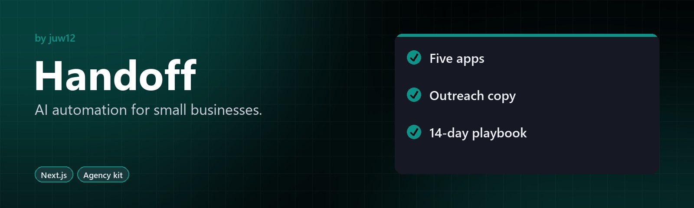

<!-- HERO:START -->
<p align="center">
  <a href="https://github.com/juw12/loop-zero"></a>
</p>

<p align="center">
  <b>AI automation for small businesses.</b><br>
  An agency starter kit plus a SaaS product: five Next.js apps, outreach copy and a 14-day validation playbook.
</p>

<p align="center">
  <a href="#highlights">Highlights</a> ·
  <a href="https://github.com/juw12">More by juw12</a>
</p>

<p align="center">
  <a href="https://github.com/juw12/loop-zero"></a>
  
  
</p>

<a id="highlights"></a>
<table>
  <tr>
    <td width="33%" valign="top">
      <b>Five apps</b><br>
      Next.js apps ready to show and sell.
    </td>
    <td width="33%" valign="top">
      <b>Outreach copy</b><br>
      Cold-outreach templates for small businesses.
    </td>
    <td width="33%" valign="top">
      <b>14-day playbook</b><br>
      A step-by-step plan to validate the agency.
    </td>
  </tr>
</table>
<!-- HERO:END -->

## About

Everything you need to launch the AI automation agency this week. Built for worldwide SMBs.

```
agency-starter/
├── docs/                     Marketing copy + ops (4 files, ~2,300 words)
├── portfolio/                Production-ready single-page Next.js site
├── demos/
│   ├── review-responder/     Live demo: paste a review, get a reply
│   └── listing-writer/       Live demo: property details → listing
├── templates/
│   └── fake-door/            Reusable niche-validation landing page
└── research/
    ├── niche-shortlist.md    5 scored candidate niches
    └── validation-playbook.md  14-day playbook to pick the winner
```

---

## What's done vs. what needs you

Most of this kit is ready. Three things only you can do:

1. **Pick a brand name** in `docs/brand.md` (3 options provided).
2. **Add your API key** to the two demos (OpenAI or Anthropic).
3. **Buy a domain** (~฿350/year) when you're ready to deploy publicly. Defer this if you're not ready to take traffic.

---

## Quick start — run everything locally

You need Node.js 20+ (or use the portable-nodejs skill). From `agency-starter/`:

```powershell
# 1. Portfolio site (no API key needed)
cd portfolio
npm install
npm run dev          # → http://localhost:3000

# 2. Demos (need API key)
cd ..\demos\review-responder
npm install
Copy-Item .env.example .env.local
# edit .env.local — paste your LLM_API_KEY
npm run dev          # → http://localhost:3000 (different terminal)

# same for ..\listing-writer

# 3. Fake-door template
cd ..\..\templates\fake-door
npm install
npm run dev          # → http://localhost:3000 (different terminal)
```

All four apps run side-by-side. The portfolio is your marketing site; the demos are portfolio pieces and first-deliverable templates; the fake-door is your niche-validation tool.

---

## Decisions you need to make (in order)

### 1. Pick a brand name (5 minutes)

Read `docs/brand.md`. Three options. Pick one. The portfolio site uses `{BRAND_NAME}` as a placeholder — find-and-replace once you've chosen.

Recommendation for fastest launch: **Handoff** — short, English-friendly, descriptive.

Once picked, replace `{BRAND_NAME}` everywhere:
- `portfolio/components/Nav.tsx`
- `portfolio/components/Hero.tsx`
- `portfolio/components/Footer.tsx`
- `portfolio/README.md`

### 2. Replace placeholder URLs (10 minutes)

Find-and-replace these two URLs across the portfolio:
- `https://calendly.com/your-handle/15min` → your real Calendly link (or just a `mailto:` for now)
- `/demo/review-responder` and `/demo/listing-writer` → your deployed demo URLs after Vercel deploy

### 3. Get an API key (5 minutes)

If you don't have one already:
- **OpenAI**: https://platform.openai.com/api-keys → top up $5–10 to start
- **Anthropic**: https://console.anthropic.com/ → same

Cheapest models: `gpt-4o-mini` (OpenAI) or `claude-3-5-haiku-latest` (Anthropic). Either works.

### 4. Deploy everything (30 minutes)

Recommended order:

1. **Portfolio first** — this is what you put on your domain. Deploy to Vercel:
   ```powershell
   cd portfolio
   npx vercel              # first time: confirm Next.js preset
   npx vercel --prod       # promote to production
   ```

2. **Demos next** — same process for `demos/review-responder` and `demos/listing-writer`. Add your `LLM_API_KEY` in the Vercel project settings → Environment Variables. **Never commit API keys.**

3. **Fake-door template** — only deploy when you start validation. Use one deployment per niche test (clone, swap copy, deploy).

### 5. Send your first outreach (Day 3–5)

Use `docs/outreach.md`. Pick one niche from `research/niche-shortlist.md`. Send 10 cold emails + 10 LinkedIn DMs. Track responses in `docs/notion-crm.md` (build the Notion database from the schema).

---

## File-by-file summary

### docs/brand.md
3 brand name options with taglines, positioning paragraphs, and rationale. **Pick one.**

### docs/services.md
3 service packages with pricing, what's included, timelines, FAQs. Use as the source of truth for what you sell.

### docs/outreach.md
2 cold email templates + 2 LinkedIn DM scripts. Personalize before sending.

### docs/notion-crm.md
Lead tracker schema. Copy into a new Notion database. Add your first 5 rows when you start outreach.

### portfolio/
Single-page Next.js portfolio site. Replace `{BRAND_NAME}` and deploy. Vercel free tier is fine.

### demos/review-responder/
Live Next.js app. Paste a customer review, get a professional reply. Uses your `LLM_API_KEY`. Doubles as a portfolio piece and the first deliverable template for any SMB with public reviews.

### demos/listing-writer/
Live Next.js app. Fill in property details, get a listing. Uses your `LLM_API_KEY`. Doubles as a portfolio piece and the first deliverable template for real-estate agents.

### templates/fake-door/
Single-page Next.js landing page. Edit `content.ts` to swap headline, subhead, features, CTA. Edit `app/globals.css` to swap brand color. Deploy, share link in 2–3 niche-specific groups, read `leads.json` to gauge interest.

### research/niche-shortlist.md
5 candidate niches scored on Pain × WTP × Reach. Top pick is **independent real estate agents**.

### research/validation-playbook.md
14-day playbook for testing which niche has real demand. Uses the fake-door template. Costs 5 hours and ฿0 to run.

---

## What's NOT in this kit (on purpose)

These are the parts that print money. You do them:

- **Sending outreach.** No bot can do this for you — it has to be you.
- **Discovery calls.** Talking to prospects.
- **Closing the first deal.** Negotiation is human work.
- **Fulfilling the first Quick Bot.** The demos are templates; the actual delivery is you building on top of them.
- **Posting on socials.** Build in public, share wins, document the journey.

This kit gives you the assets. You run the business.

---

## 14-day launch checklist

- [ ] **Day 1:** Pick brand name from `docs/brand.md`. Replace `{BRAND_NAME}` in portfolio.
- [ ] **Day 1:** Buy a domain. ~฿350/year. Skip if budget is tight.
- [ ] **Day 2:** Get API key. Add to `demos/*/.env.local`. Run all 4 apps locally.
- [ ] **Day 3:** Deploy portfolio to Vercel. Set up DNS.
- [ ] **Day 4:** Deploy both demos to Vercel. Add env vars.
- [ ] **Day 5:** Deploy fake-door for top niche (real estate).
- [ ] **Day 5–7:** Send 20 cold outreach messages using `docs/outreach.md`.
- [ ] **Day 7:** Set up Notion CRM. Log all responses.
- [ ] **Day 8–10:** Run 5 discovery calls using `research/validation-playbook.md`.
- [ ] **Day 11–14:** Share fake-door links in niche groups. Track signups.
- [ ] **Day 14:** Decide: build / iterate / kill the niche.

By Day 14 you should have:
- A live portfolio on your domain.
- Two working demos anyone can try.
- 20+ outreach messages sent.
- 5+ discovery calls completed.
- 50+ fake-door email signups (or a kill signal).
- A clear answer on which niche to build for.

If you have all that by Day 14, the agency is real.

---

## When something breaks

- **Build errors:** Run `npm install` first. If still broken, delete `node_modules/` and `.next/`, then re-install.
- **Demo API errors:** Check `.env.local` has `LLM_API_KEY` set. Check you have credit on your OpenAI / Anthropic account.
- **Vercel deploy fails:** Check the build log. Usually a missing env var or a typo in code.
- **Tailwind classes not applying:** The Tailwind config is per-app. Don't share configs across apps.
- **Port already in use:** Run `npx kill-port 3000` before starting another app on the same port.

---

## License

Released under the [MIT License](LICENSE) © 2026 Juwen Lie. Contributions are welcome under the same license; see the [contributing guide](https://github.com/juw12/.github/blob/main/CONTRIBUTING.md) and [Code of Conduct](https://github.com/juw12/.github/blob/main/CODE_OF_CONDUCT.md).
